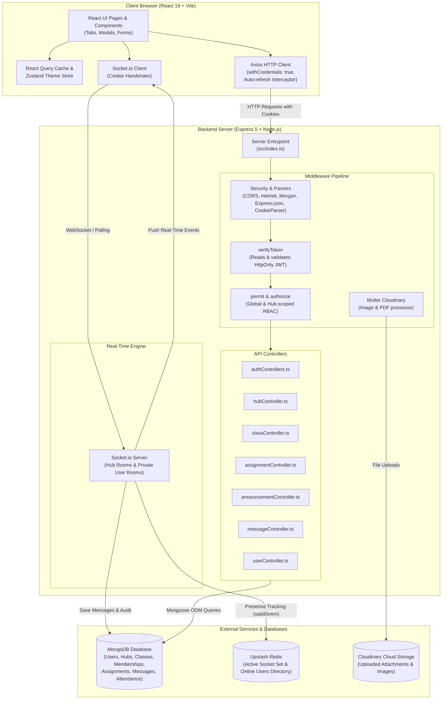

# EduSpace System Architecture Map

Welcome to your architecture map! The goal of this document is to demystify how your platform is built, how data moves through it, and why things were structured this way.

Whenever a technical term appears for the first time, it is explained in plain English before we use it.

---

## 1. High-Level Concept: What is this App?

**EduSpace** is a full-stack educational web application designed as a hybrid between **Moodle** (a Learning Management System for courses and assignments) and **Upwork / Private Tutoring** (a marketplace where teachers host subjects and communicate directly with students).

It is built on the **MERN stack**:
- **MongoDB**: The document-based database where all records are stored as JSON-like documents.
- **Express**: The backend web server framework that listens for HTTP requests and routes them to handler functions.
- **React**: The frontend user interface (UI) library that renders dynamic web pages in the browser.
- **Node.js**: The JavaScript runtime environment that executes backend code on your server machine.

---

## 2. Overall Architecture Diagram

Here is a visual map showing how the browser, backend server, real-time socket connections, database, caching layer, and media storage fit together:



---

## 3. Folder Structure: One-Line Summary per Item

### Root Directory
- `backend/`: Node.js, Express, and MongoDB backend application code and tests.
- `frontend/`: React 19, Vite, and Tailwind CSS client-side application code.
- `README.md`: Project overview and setup notes.
- `.gitignore`: Specifies intentionally untracked files (e.g. `node_modules`, `.env`) that Git ignores.
- `.gitattributes`: Configures line endings and Git repository attributes.

### Backend (`/backend`)
- [`backend/package.json`](file:///c:/Users/Bestpc.tn/teaching_platform_v2/backend/package.json): Lists Node dependencies (Express, Mongoose, Socket.io, Upstash Redis, Multer, Zod, Vitest) and run scripts (`dev`, `build`, `test`).
- [`backend/src/index.ts`](file:///c:/Users/Bestpc.tn/teaching_platform_v2/backend/src/index.ts): Main backend server entry point; initializes Express, HTTP server, Socket.io, global middleware, API routes, and real-time socket events.
- [`backend/src/types.d.ts`](file:///c:/Users/Bestpc.tn/teaching_platform_v2/backend/src/types.d.ts): TypeScript type declaration extending Express's `Request` object with `req.user`.

#### Backend Controllers (`/backend/src/controllers`)
*Controllers contain the business logic executed when an API route is called.*
- [`authControllers.ts`](file:///c:/Users/Bestpc.tn/teaching_platform_v2/backend/src/controllers/authControllers.ts): Handles user registration, credential verification, JWT issuance via HttpOnly cookies, token refreshes, and logout.
- [`hubController.ts`](file:///c:/Users/Bestpc.tn/teaching_platform_v2/backend/src/controllers/hubController.ts): Manages Hub creation, updates, deletes, roster lists, student kicking, dashboard stats, invite links, and channel locking.
- [`classController.ts`](file:///c:/Users/Bestpc.tn/teaching_platform_v2/backend/src/controllers/classController.ts): Manages sub-groups ("classes"/"cohorts"), scheduling conflict checks, student enrollment, and session attendance tracking.
- [`assignmentController.ts`](file:///c:/Users/Bestpc.tn/teaching_platform_v2/backend/src/controllers/assignmentController.ts): Handles assignment and homework creation with attachments, listing assignments by Hub, and single assignment lookups.
- [`announcementController.ts`](file:///c:/Users/Bestpc.tn/teaching_platform_v2/backend/src/controllers/announcementController.ts): Creates feed announcements targeting specific Hubs or classes, and retrieves Hub announcement feeds.
- [`messageController.ts`](file:///c:/Users/Bestpc.tn/teaching_platform_v2/backend/src/controllers/messageController.ts): Fetches historical chat transcripts for both 1-on-1 private messaging and public Hub channel chat.
- [`userController.ts`](file:///c:/Users/Bestpc.tn/teaching_platform_v2/backend/src/controllers/userController.ts): Handles user profile lookups, recent chat contacts management, and teacher/student listing.

#### Backend Middleware (`/backend/src/middleware`)
*Middleware are functions that run before reaching the controller to check credentials, validate inputs, or parse files.*
- [`verifyToken.ts`](file:///c:/Users/Bestpc.tn/teaching_platform_v2/backend/src/middleware/verifyToken.ts): Checks incoming cookies for a valid JSON Web Token (`accessToken`) and populates `req.user`.
- [`requireGlobalRole.ts`](file:///c:/Users/Bestpc.tn/teaching_platform_v2/backend/src/middleware/requireGlobalRole.ts): `permit(...)` guard ensuring the user has a platform-wide role (e.g. only `"teacher"` or `"student"`).
- [`requireHubRole.ts`](file:///c:/Users/Bestpc.tn/teaching_platform_v2/backend/src/middleware/requireHubRole.ts): `authorize(...)` guard querying the `Membership` database to ensure a user is an `"owner"`, `"co_teacher"`, or `"student"` of that specific Hub.
- [`resolvers.ts`](file:///c:/Users/Bestpc.tn/teaching_platform_v2/backend/src/middleware/resolvers.ts): Helper middleware that translates a `:classId` or `:assignmentId` into a parent `hubId` before `authorize` runs.
- [`validateRequest.ts`](file:///c:/Users/Bestpc.tn/teaching_platform_v2/backend/src/middleware/validateRequest.ts): Uses Zod schemas to validate incoming `req.body` data and returns 400 Bad Request on malformed inputs.
- [`upload.ts`](file:///c:/Users/Bestpc.tn/teaching_platform_v2/backend/src/middleware/upload.ts): Configures Multer with Cloudinary storage to intercept multipart file uploads (images, PDFs).

#### Backend Models (`/backend/src/models`)
*Models define the database schema (shape of the data) for MongoDB collections via Mongoose.*
- [`User.ts`](file:///c:/Users/Bestpc.tn/teaching_platform_v2/backend/src/models/User.ts): User profile, role, password hash, hashed refresh token, and associated hub/contact relationships.
- [`Hub.ts`](file:///c:/Users/Bestpc.tn/teaching_platform_v2/backend/src/models/Hub.ts): Main workspace representing a teacher's subject hub, containing sub-classes, members, and locked channels.
- [`Class.ts`](file:///c:/Users/Bestpc.tn/teaching_platform_v2/backend/src/models/Class.ts): A scheduled cohort or sub-group under a Hub with its own meeting time, type, duration, and roster.
- [`Membership.ts`](file:///c:/Users/Bestpc.tn/teaching_platform_v2/backend/src/models/Membership.ts): Join table associating a `User` with a `Hub` along with their specific role within that Hub (`owner`, `co_teacher`, `student`).
- [`Announcement.ts`](file:///c:/Users/Bestpc.tn/teaching_platform_v2/backend/src/models/Announcement.ts): Feed post containing text updates, attachments, and target Hubs/classes.
- [`Assignment.ts`](file:///c:/Users/Bestpc.tn/teaching_platform_v2/backend/src/models/Assignment.ts): Coursework task with due date, points, category, attachments, and targeted cohorts.
- [`submission.ts`](file:///c:/Users/Bestpc.tn/teaching_platform_v2/backend/src/models/submission.ts): Student work submission for an assignment with grade and teacher feedback.
- [`Attendance.ts`](file:///c:/Users/Bestpc.tn/teaching_platform_v2/backend/src/models/Attendance.ts): Per-session attendance log tracking whether a student was "Present", "Absent", or "Late".
- [`Message.ts`](file:///c:/Users/Bestpc.tn/teaching_platform_v2/backend/src/models/Message.ts): Stores text and image chat messages for both public Hub channels and 1-on-1 private direct messages.

#### Backend Routes (`/backend/src/routes`)
*Routes map HTTP endpoints (e.g. `POST /api/auth/login`) to middleware chains and controllers.*
- [`auth.ts`](file:///c:/Users/Bestpc.tn/teaching_platform_v2/backend/src/routes/auth.ts): Routes for register, login, refresh token, and logout.
- [`user.ts`](file:///c:/Users/Bestpc.tn/teaching_platform_v2/backend/src/routes/user.ts): Routes for searching users, getting contacts, and listing teachers/students.
- [`hub.ts`](file:///c:/Users/Bestpc.tn/teaching_platform_v2/backend/src/routes/hub.ts): Routes for CRUD operations on Hubs, invites, member roster, channel locks, and stats.
- [`class.ts`](file:///c:/Users/Bestpc.tn/teaching_platform_v2/backend/src/routes/class.ts): Routes for creating/editing cohorts, assigning students, and submitting attendance.
- [`announcement.ts`](file:///c:/Users/Bestpc.tn/teaching_platform_v2/backend/src/routes/announcement.ts): Routes for creating announcements and fetching Hub news feeds.
- [`assignment.ts`](file:///c:/Users/Bestpc.tn/teaching_platform_v2/backend/src/routes/assignment.ts): Routes for creating tasks and fetching assignments by Hub or by ID.
- [`message.ts`](file:///c:/Users/Bestpc.tn/teaching_platform_v2/backend/src/routes/message.ts): Routes for querying public and private chat histories.
- [`upload.ts`](file:///c:/Users/Bestpc.tn/teaching_platform_v2/backend/src/routes/upload.ts): Standalone file upload endpoint returning a Cloudinary image URL.

#### Backend Services, Schemas & Tests
- [`redis.ts`](file:///c:/Users/Bestpc.tn/teaching_platform_v2/backend/src/services/redis.ts): Upstash Redis client managing user connection count sets and global online status.
- [`authSchemas.ts`](file:///c:/Users/Bestpc.tn/teaching_platform_v2/backend/src/schemas/authSchemas.ts): Zod validation schemas for registration and login request bodies.
- [`auth.test.ts`](file:///c:/Users/Bestpc.tn/teaching_platform_v2/backend/src/tests/auth.test.ts): Vitest integration tests asserting registration validation and cookie issuance against an in-memory MongoDB server.

---

### Frontend (`/frontend`)
- [`frontend/package.json`](file:///c:/Users/Bestpc.tn/teaching_platform_v2/frontend/package.json): Lists UI dependencies (React 19, React Router 7, TanStack React Query, Axios, Socket.io-client, Zustand, Tailwind CSS, Zod, React Hook Form) and Vite scripts.
- [`frontend/src/main.tsx`](file:///c:/Users/Bestpc.tn/teaching_platform_v2/frontend/src/main.tsx): Client entry point that mounts the root React component to `<div id="root">`.
- [`frontend/src/App.tsx`](file:///c:/Users/Bestpc.tn/teaching_platform_v2/frontend/src/App.tsx): Main router configuration defining public, auth, and protected routes, and wrapping the app in Providers (`AuthProvider`, `QueryClientProvider`, `SocketProvider`).
- [`frontend/src/loaders.ts`](file:///c:/Users/Bestpc.tn/teaching_platform_v2/frontend/src/loaders.ts): React Router loaders that fetch data before route components render (`dashboardLoader`, `HubLoader`, `StudentsLoader`).

#### Frontend Context & State (`/frontend/src/context`, `/frontend/src/store`)
- [`AuthContext.tsx`](file:///c:/Users/Bestpc.tn/teaching_platform_v2/frontend/src/context/AuthContext.tsx): React Context storing the logged-in user in memory and keeping it in sync with `localStorage`.
- [`SocketContext.tsx`](file:///c:/Users/Bestpc.tn/teaching_platform_v2/frontend/src/context/SocketContext.tsx): React Context establishing the Socket.io client connection, managing global unread message count, and popping instant message toast notifications.
- [`ThemeStore.ts`](file:///c:/Users/Bestpc.tn/teaching_platform_v2/frontend/src/store/ThemeStore.ts): Zustand store managing light/dark mode and syncing the class with `document.documentElement` and `localStorage`.

#### Frontend Layouts & Routes (`/frontend/src/layouts`, `/frontend/src/routes`)
- [`DashboardLayout.tsx`](file:///c:/Users/Bestpc.tn/teaching_platform_v2/frontend/src/layouts/DashboardLayout.tsx): Layout wrapper containing the permanent `Sidebar` and the main dynamic view area.
- [`HubWorkspaceLayout.tsx`](file:///c:/Users/Bestpc.tn/teaching_platform_v2/frontend/src/layouts/HubWorkspaceLayout.tsx): Header, invite link generator, student counter, and tab navigation bar (`feed`, `chat`, `schedule`, `assignments`, `roster`, `vault`) for a specific Hub.
- [`Sidebar.tsx`](file:///c:/Users/Bestpc.tn/teaching_platform_v2/frontend/src/layouts/Sidebar.tsx): Global left navigation bar displaying links, unread message badges, theme switch button, and user logout button.
- [`ProtectedRoute.tsx`](file:///c:/Users/Bestpc.tn/teaching_platform_v2/frontend/src/routes/ProtectedRoute.tsx): Route guard checking if `user` exists in `AuthContext`; redirects unauthenticated visitors to `/auth/login`.

#### Frontend Pages (`/frontend/src/pages`)
- [`Login.tsx`](file:///c:/Users/Bestpc.tn/teaching_platform_v2/frontend/src/pages/Login.tsx): User login form; submits credentials to backend and updates `AuthContext`.
- [`Register.tsx`](file:///c:/Users/Bestpc.tn/teaching_platform_v2/frontend/src/pages/Register.tsx): Registration form with role switcher ("Teacher" vs. "Student").
- [`Dashboard.tsx`](file:///c:/Users/Bestpc.tn/teaching_platform_v2/frontend/src/pages/Dashboard.tsx): Teacher dashboard showing created Hubs with options to add, edit, or delete them.
- [`StudentDashboard.tsx`](file:///c:/Users/Bestpc.tn/teaching_platform_v2/frontend/src/pages/StudentDashboard.tsx): Student dashboard showing enrolled Hubs and an invite token input to join new Hubs.
- [`Messages.tsx`](file:///c:/Users/Bestpc.tn/teaching_platform_v2/frontend/src/pages/Messages.tsx): Full-page 1-on-1 private messaging center with contact search, file attachment uploads, and real-time chat.
- [`LandingPage.tsx`](file:///c:/Users/Bestpc.tn/teaching_platform_v2/frontend/src/pages/public/LandingPage.tsx): Public landing page with links to register as teacher or find a tutor.
- [`GlobalSearch.tsx`](file:///c:/Users/Bestpc.tn/teaching_platform_v2/frontend/src/pages/public/GlobalSearch.tsx): Public placeholder for tutor search.
- [`TeacherProfile.tsx`](file:///c:/Users/Bestpc.tn/teaching_platform_v2/frontend/src/pages/public/TeacherProfile.tsx): Public placeholder for viewing a teacher's bio and reviews.

#### Frontend Tabs (`/frontend/src/pages/tabs`)
*These components render inside the `<Outlet />` of `HubWorkspaceLayout` based on the active tab URL.*
- [`FeedTab.tsx`](file:///c:/Users/Bestpc.tn/teaching_platform_v2/frontend/src/pages/tabs/FeedTab.tsx): Shows reverse-chronological announcements with attachments and a modal for teachers to post new announcements.
- [`ChatTab.tsx`](file:///c:/Users/Bestpc.tn/teaching_platform_v2/frontend/src/pages/tabs/ChatTab.tsx): Hub communication view containing public channels (`#general`, `#homework`), direct messages with teacher/students, and teacher channel locking controls.
- [`ScheduleTab.tsx`](file:///c:/Users/Bestpc.tn/teaching_platform_v2/frontend/src/pages/tabs/ScheduleTab.tsx): Lists all cohort groups under this Hub and provides modals to create or edit cohort session times.
- [`AssignmentTab.tsx`](file:///c:/Users/Bestpc.tn/teaching_platform_v2/frontend/src/pages/tabs/AssignmentTab.tsx): Card grid displaying assignments, homework, and exams, with a React Hook Form + Zod modal for teachers to publish new tasks.
- [`RosterTab.tsx`](file:///c:/Users/Bestpc.tn/teaching_platform_v2/frontend/src/pages/tabs/RosterTab.tsx): Roster table showing enrolled students, option for teachers to kick students, and a modal to submit session attendance.
- [`VaultTab.tsx`](file:///c:/Users/Bestpc.tn/teaching_platform_v2/frontend/src/pages/tabs/VaultTab.tsx): Empty placeholder file intended for file/materials storage.

#### Frontend Features & UI (`/frontend/src/features`, `/frontend/src/components/ui`)
- [`HubCard.tsx`](file:///c:/Users/Bestpc.tn/teaching_platform_v2/frontend/src/features/hubs/HubCard.tsx): Reusable card rendering Hub title, student count, invite token copy button, and link to open the Hub workspace.
- [`JoinHub.tsx`](file:///c:/Users/Bestpc.tn/teaching_platform_v2/frontend/src/features/hubs/JoinHub.tsx): Automatic join route component triggered when visiting `/join/:inviteToken`.
- [`ClassCard.tsx`](file:///c:/Users/Bestpc.tn/teaching_platform_v2/frontend/src/features/cohorts/ClassCard.tsx): Card displaying cohort title, schedule, duration, student enrollment, manual student assignment, and action buttons.
- [`CreateCohortModal.tsx`](file:///c:/Users/Bestpc.tn/teaching_platform_v2/frontend/src/features/cohorts/CreateCohortModal.tsx): Modal dialog collecting cohort title, day of week, time, duration, and meeting type.
- [`EditCohortModal.tsx`](file:///c:/Users/Bestpc.tn/teaching_platform_v2/frontend/src/features/cohorts/EditCohortModal.tsx): Modal dialog for editing an existing cohort's schedule and metadata.
- [`Button.tsx`](file:///c:/Users/Bestpc.tn/teaching_platform_v2/frontend/src/components/ui/Button.tsx): Reusable styled button component.
- [`Input.tsx`](file:///c:/Users/Bestpc.tn/teaching_platform_v2/frontend/src/components/ui/Input.tsx): Reusable styled input component.
- [`Toast.tsx`](file:///c:/Users/Bestpc.tn/teaching_platform_v2/frontend/src/components/ui/Toast.tsx): Reusable toast banner component for success and error alerts.

---

## 4. Data Model (MongoDB & Mongoose)

All database entities are represented as Mongoose models. Here is each collection, its key fields, and how they relate to one another:

### 4.1. `User` (Collection: `users`)
- **Important Fields**:
  - `username` *(String, required)*: Display name.
  - `email` *(String, required)*: Unique login identifier.
  - `password` *(String, required, select: false)*: Bcrypt-hashed password. Stripped automatically from JSON outputs.
  - `role` *(String: "student" | "teacher" | "admin", default: "student")*: Platform-wide role.
  - `hubs` *([ObjectId ref 'Hub'])*: List of Hubs the user created (if teacher) or joined (if student).
  - `recentUsers` *([ObjectId ref 'User'])*: Contact history list used by the Direct Messaging sidebar.
  - `refreshToken` *(String, select: false)*: Bcrypt-hashed JWT refresh token stored on the user record.
- **Relationships**:
  - A Teacher has many Hubs (`Hub.teacher`).
  - A User has many Hub Memberships (`Membership.user`).
  - A User is author of Messages (`Message.sender`) or recipient (`Message.receiver`).

### 4.2. `Hub` (Collection: `hubs`)
- **Important Fields**:
  - `title` *(String, required)*: Subject or course title (e.g. "3ème Math").
  - `teacher` *(ObjectId ref 'User', required)*: The teacher who created and owns this Hub.
  - `students` *([ObjectId ref 'User'])*: Array of enrolled student IDs.
  - `lockedChannels` *([String])*: Names of channels locked by the teacher (e.g. `["general"]`), preventing students from chatting.
  - `classes` *([ObjectId ref 'Class'])*: Sub-classes or cohorts belonging to this Hub.
  - `announcements` *([ObjectId ref 'Announcement'])*: Feed items posted in this Hub.
  - `inviteToken` *(String, unique)*: Random 16-character hex string used in invite links to let students join.
  - `messages` *([ObjectId ref 'Message'])*: Array of message IDs (Note: currently messages reference `hubId` directly, so this array is mostly unused).
- **Relationships**:
  - One Hub belongs to one teacher (`User`).
  - One Hub has many sub-groups (`Class`).
  - One Hub has many `Membership` records defining permissions.

### 4.3. `Class` (Collection: `classes`)
*In the UI, these are called "Cohorts" or "Sub-Groups".*
- **Important Fields**:
  - `title` *(String, required)*: Name of the cohort (e.g. "Group A").
  - `teacher` *(ObjectId ref 'User', required)*: Teacher in charge.
  - `hub` *(ObjectId ref 'Hub', required)*: Parent Hub this cohort belongs to.
  - `students` *([ObjectId ref 'User'])*: Specific students assigned to this group.
  - `date` *(String)*: Human-readable scheduled time (e.g. "Mondays at 14:00").
  - `duration` *(String, default: "1h 00m")*: Meeting length.
  - `type` *(String, default: "Live Video")*: Delivery mode ("In Person", "Live Video", "Hybrid").
  - `inviteToken` *(String, unique, sparse)*: Optional cohort-specific invite token.
  - `dues` *(Number, default: 0)*: Fee per student (used by teacher dashboard revenue calculation).
- **Relationships**:
  - Belongs to a parent `Hub`.
  - Enrolls a subset of students who belong to the parent `Hub`.

### 4.4. `Membership` (Collection: `memberships`)
*This is a "join collection" providing fine-grained permissions per Hub.*
- **Important Fields**:
  - `user` *(ObjectId ref 'User', required)*: The member.
  - `hub` *(ObjectId ref 'Hub', required)*: The Hub.
  - `role` *(String: "owner" | "co_teacher" | "student", default: "student")*: Role inside this specific Hub.
- **Index**:
  - `{ user: 1, hub: 1 }` is unique, guaranteeing a user cannot have duplicate memberships in the same Hub.
- **Why this exists**:
  - A user could be a `"student"` in one Hub and potentially a `"co_teacher"` in another. It prevents hardcoding access logic solely to the global `user.role`.

### 4.5. `Announcement` (Collection: `announcements`)
- **Important Fields**:
  - `title` *(String, required)*: Headline of the announcement.
  - `description` *(String)*: Detailed announcement body.
  - `teacher` *(ObjectId ref 'User', required)*: Author.
  - `hubs` *([ObjectId ref 'Hub'], required)*: Array of Hubs that should display this announcement.
  - `targetClasses` *([ObjectId ref 'Class'])*: Optional list of cohorts targeted by this announcement.
  - `imageUrl` *(String)*: Cloudinary CDN link to an attached document or image.

### 4.6. `Assignment` (Collection: `assignments`)
- **Important Fields**:
  - `title` *(String, required)*: Task name.
  - `description` *(String)*: Instructions or question details.
  - `dueDate` *(Date, required)*: Submission deadline.
  - `totalPoints` *(Number, default: 100)*: Maximum score.
  - `attachments` *([String])*: Cloudinary CDN URLs for worksheets or prompts.
  - `hub` *(ObjectId ref 'Hub', required)*: Parent Hub.
  - `classes` *([ObjectId ref 'Class'])*: Specific cohorts this assignment was assigned to.
  - `teacher` *(ObjectId ref 'User', required)*: Teacher creator.
  - `type` *(String: "assignment" | "homework" | "quiz" | "project" | "exam")*: Classification tag.
  - `status` *(String: "draft" | "published" | "closed", default: "published")*: Publishing state.

### 4.7. `Submission` (Collection: `submissions`)
- **Important Fields**:
  - `assignment` *(ObjectId ref 'Assignment', required)*: The assignment being answered.
  - `student` *(ObjectId ref 'User', required)*: Student submitting work.
  - `content` *(String)*: Written text response.
  - `attachments` *([String])*: Cloudinary CDN URLs for student work files.
  - `grade` *(Number)*: Score assigned by the teacher.
  - `feedback` *(String)*: Teacher remarks.
  - `status` *(String: "submitted" | "graded" | "returned", default: "submitted")*.
- **Index**:
  - `{ assignment: 1, student: 1 }` is unique (one submission per student per assignment).
- **Status in Code**:
  - **UNSURE / UNFINISHED**: While the model exists, there are currently no controllers or routes that allow students to submit work or teachers to grade it.

### 4.8. `Attendance` (Collection: `attendances`)
- **Important Fields**:
  - `student` *(ObjectId ref 'User', required)*: Student being marked.
  - `classCohort` *(ObjectId ref 'Class', required)*: Cohort meeting.
  - `date` *(Date, required)*: Date of the session.
  - `status` *(String: "Present" | "Absent" | "Late", required)*: Attendance status.

### 4.9. `Message` (Collection: `messages`)
- **Important Fields**:
  - `sender` *(ObjectId ref 'User', required)*: Author of the message.
  - `text` *(String)*: Message text content.
  - `imageUrl` *(String)*: Optional Cloudinary file attachment.
  - *For Public Hub Chat*:
    - `hubId` *(ObjectId ref 'Hub')*: The Hub where the message was sent.
    - `channel` *(String, default: "general")*: Channel room (e.g. "general" or "homework").
  - *For Private Direct Message*:
    - `receiver` *(ObjectId ref 'User')*: Target recipient of the 1-on-1 chat.

---

## 5. Backend Request Pipeline

When an HTTP request hits the backend server, it flows through a sequential chain of middleware before executing the controller logic.

### 5.1. Global Middleware (Order of Execution in `src/index.ts`)
1. **`cors(...)`**: Checks the `Origin` header. Ensures only requests from `http://localhost:5173` are accepted, and enables `credentials: true` so cookies are allowed across origins.
2. **`express.json()`**: Reads raw incoming JSON request bodies and parses them into `req.body`.
3. **`cookieParser()`**: Reads the raw `Cookie` header sent by the browser and parses it into `req.cookies`.
4. **`helmet(...)`**: Sets HTTP security headers to protect against common web attacks. `crossOriginResourcePolicy: false` is set so embedded media can load.
5. **`morgan("common")`**: Logs HTTP requests, status codes, and response times in the server console.

### 5.2. Route-Level Middleware & Access Control
When an endpoint is matched (e.g. `POST /api/class/createClass`), Express runs the specified route-level middleware in left-to-right order:

```
[Request]
   │
   ▼
[1. verifyToken] ──(Checks HttpOnly cookie; verifies JWT)──► 401 if invalid/missing
   │
   ▼
[2. Context Resolver] ──(e.g. resolveHubFromClass: finds hubId from classId)
   │
   ▼
[3. RBAC Permission Guard] 
   ├── permit("teacher") ──(Checks req.user.role)──► 403 if forbidden
   └── authorize("owner", "co_teacher") ──(Checks Membership table)──► 403 if forbidden
   │
   ▼
[4. validateRequest(schema)] ──(Checks req.body with Zod)──► 400 if malformed
   │
   ▼
[5. upload.single("image")] ──(Multer streams file to Cloudinary)──► req.file.path
   │
   ▼
[6. Controller Handler] ──(Interacts with Mongoose & returns JSON response)
```

#### How Auth and Tokens Work (JWT + HttpOnly Cookies)
- **Access Token**: Short-lived (15 minutes). Contains `{ userId, email, username, role }`. Signed with `JWT_SECRET`.
- **Refresh Token**: Long-lived (7 days). Contains `{ userId }`. Signed with `REFRESH_TOKEN_SECRET`. Its bcrypt hash is stored in the `User` database document (`user.refreshToken`).
- **Security design**: Both tokens are sent in **`HttpOnly` cookies** (`sameSite: "lax"`, `secure: false` in dev, `true` in prod). 
  - *Why HttpOnly?* JavaScript running in the browser cannot read `document.cookie`. This protects tokens from being stolen if someone injects malicious scripts (XSS attacks).

#### How Permissions are Checked (RBAC - Role-Based Access Control)
1. **Global Role Guard (`permit`)**:
   - [`requireGlobalRole.ts`](file:///c:/Users/Bestpc.tn/teaching_platform_v2/backend/src/middleware/requireGlobalRole.ts)
   - Checks `req.user.role`. Used for actions that are platform-wide (e.g., creating a Hub is restricted to teachers via `permit("teacher")`).
2. **Hub-Scoped Role Guard (`authorize`)**:
   - [`requireHubRole.ts`](file:///c:/Users/Bestpc.tn/teaching_platform_v2/backend/src/middleware/requireHubRole.ts)
   - Extracts the `hubId` from route parameters or request body.
   - Looks up the `Membership` document matching `{ user: req.user.userId, hub: hubId }`.
   - Checks whether the user's hub role (`owner`, `co_teacher`, `student`) matches the allowed roles.
   - Used for actions inside a Hub (e.g., editing Hub details or locking channels requires `"owner"`).

### 5.3. Error Handling
- There is currently **no central error-handling middleware** in Express (i.e. no `app.use((err, req, res, next) => ...)` at the bottom of `src/index.ts`).
- Instead, each controller wraps its code inside a `try { ... } catch (err) { ... }` block and manually writes:
  ```ts
  if (err instanceof Error) {
    res.status(500).json({ error: err.message });
  } else {
    res.status(500).json("An unknown error occurred");
  }
  ```
- **Consequence**: If an asynchronous error occurs outside a `try/catch` block (for example, in a middleware function that does not wrap an async call), it could cause an unhandled promise rejection.

---

## 6. Frontend Structure

The frontend is a single-page application (SPA) created with **Vite** and **React 19**.

### 6.1. Routing Architecture
Defined in [`frontend/src/App.tsx`](file:///c:/Users/Bestpc.tn/teaching_platform_v2/frontend/src/App.tsx) using React Router's `createBrowserRouter`:
- **Code Splitting**: All page views are imported dynamically using `React.lazy()` and wrapped in `<Suspense fallback={<Loader />}>`. This means the user's browser only downloads code for a page when they actually visit it.
- **Route Layers**:
  1. **Public Layer**: `/`, `/search`, `/teacher/:username`.
  2. **Auth Layer**: `/auth/login`, `/auth/register`.
  3. **Protected Layer**: Wrapped by [`ProtectedRoute`](file:///c:/Users/Bestpc.tn/teaching_platform_v2/frontend/src/routes/ProtectedRoute.tsx). If the user is unauthenticated, it redirects to `/auth/login`, saving the intended destination in `location.state.from`.
  4. **Workspace Layout**:
     - Uses [`DashboardLayout`](file:///c:/Users/Bestpc.tn/teaching_platform_v2/frontend/src/layouts/DashboardLayout.tsx), which keeps the left `Sidebar` permanently on screen and renders child pages in the right panel.
     - Hub workspace routes (`/hubs/:hubId/*`) render inside [`HubWorkspaceLayout`](file:///c:/Users/Bestpc.tn/teaching_platform_v2/frontend/src/layouts/HubWorkspaceLayout.tsx), which displays the subject banner and tab bar (`feed`, `chat`, `schedule`, `assignments`, `roster`, `vault`).

### 6.2. State Management Strategy
The app splits state into three distinct layers:
1. **User Identity State (`AuthContext`)**:
   - Stores `{ user, loading, login, logout }`.
   - On initial load, reads `localStorage.getItem("user")` so the user stays logged in across page refreshes.
   - Note: The actual security tokens live in browser cookies; `localStorage` only holds public user metadata (name, email, role) for instant UI rendering.
2. **Server Cache State (`TanStack React Query`)**:
   - Manages asynchronous server data (hubs list, announcements, assignments, chat messages).
   - `useQuery` caches data under query keys like `['hubs']` or `['announcements', hubId]`.
   - `useMutation` triggers create/edit/delete requests and calls `queryClient.invalidateQueries(...)` on success, automatically refreshing the UI without manual state synchronization.
3. **UI Theme State (`Zustand ThemeStore`)**:
   - Manages `isDarkMode` and `toggleTheme`.
   - When toggled, it adds or removes the `.dark` CSS class on `document.documentElement` and saves `"theme"` to `localStorage`.

### 6.3. Data Fetching & Backend Communication (The Axios Interceptor)
All HTTP communication passes through the centralized client at [`frontend/src/services/api.ts`](file:///c:/Users/Bestpc.tn/teaching_platform_v2/frontend/src/services/api.ts):
- `withCredentials: true`: Automatically attaches the browser's HttpOnly cookies to every outgoing request.
- **Silent Refresh Interceptor**:
  - If any API request fails with a `401 Unauthorized` status (meaning the 15-minute `accessToken` expired), the Axios response interceptor catches the failure.
  - If `originalRequest._retry` is false, it flags `originalRequest._retry = true` and silently calls `POST /api/auth/refresh`.
  - The backend verifies the `refreshToken` cookie and issues a fresh `accessToken` cookie.
  - Axios then automatically re-executes the original request.
  - If the refresh token is also expired or invalid, the interceptor clears `localStorage.removeItem("user")` and redirects the browser to `/auth/login`.

---

## 7. Real-Time Architecture (Socket.io & Redis)

Real-time capabilities power live chat, instant notifications, channel locking, and online presence.

### 7.1. Socket Authentication & Handshake
In [`backend/src/index.ts`](file:///c:/Users/Bestpc.tn/teaching_platform_v2/backend/src/index.ts):
- Socket.io uses a connection middleware (`io.use(...)`).
- It extracts the `accessToken` from the incoming WebSocket handshake cookie string: `socket.handshake.headers.cookie`.
- It verifies the token using `jwt.verify(token, process.env.JWT_SECRET)`.
- If valid, it attaches the decoded payload to `socket.data.user = decoded`.
- If invalid or missing, it rejects the socket connection before any events can fire.

### 7.2. Redis Presence Management
Defined in [`backend/src/services/redis.ts`](file:///c:/Users/Bestpc.tn/teaching_platform_v2/backend/src/services/redis.ts) using Upstash Redis:
- **Connection Sets**: When a client connects, their socket ID is added to a Redis set keyed `user:connections:<userId>`.
- **First Connection Detection**: If `redis.scard` is 1 (the user just opened their first tab), Redis returns `isNewlyOnline = true`. The server broadcasts `user_status: "online"` to all connected clients.
- **Last Disconnect Detection**: When a socket disconnects, its ID is removed with `srem`. If the remaining count reaches 0 (the user closed all tabs), Redis returns `isNowOffline = true`. The server broadcasts `user_status: "offline"`.
- **Global Directory**: A global Redis set `online_users` tracks all currently active user IDs.

### 7.3. Rooms
1. **Private User Room (`socket.join(userId)`)**: Every socket automatically joins a room named after the authenticated user's ID. This allows the server to send private direct messages and notifications specifically to that user, regardless of what page they are on.
2. **Hub Room (`socket.join(hubId)`)**: Joined when a user opens a Hub's chat tab (`join_Hub` event).

### 7.4. Complete Socket.io Event Directory

| Event Name | Direction | Emitter File & Function | Listener File & Function | Payload | Purpose |
|---|---|---|---|---|---|
| `join_Hub` | Client ➔ Server | `ChatTab.tsx` (useEffect) | `index.ts` (`socket.on("join_Hub")`) | `hubId` | Joins the socket to the Hub's broadcast room. |
| `send_message` | Client ➔ Server | `ChatTab.tsx` (`sendMessage`) | `index.ts` (`socket.on("send_message")`) | `{ hubId, text, sender, channel }` | Sends a message to a public Hub channel. |
| `receive_message` | Server ➔ Client | `index.ts` (`io.to(hubId).emit`) | `ChatTab.tsx` (`socket.on("receive_message")`) | `Message` document | Delivers channel message to all users in the Hub. |
| `chat_error` | Server ➔ Client | `index.ts` (`socket.emit("chat_error")`) | `ChatTab.tsx` (`socket.on("chat_error")`) | `errorMessage` string | Alerts student if they try to post in a locked channel. |
| `send_private_message` | Client ➔ Server | `Messages.tsx` & `ChatTab.tsx` | `index.ts` (`socket.on("send_private_message")`) | `{ receiver, text, imageUrl }` | Sends a 1-on-1 direct message. |
| `receive_private_message` | Server ➔ Client | `index.ts` (`io.to(receiver)` & `io.to(sender)`) | `Messages.tsx`, `ChatTab.tsx`, `SocketContext.tsx` | `Message` document | Delivers private message to sender & receiver rooms. Updates unread badge and triggers toast. |
| `private_message_error` | Server ➔ Client | `index.ts` (`socket.emit`) | `Messages.tsx` (`socket.on`) | `errorMessage` string | Alerts user if student tries to message another student. |
| `user_status` | Server ➔ Client | `index.ts` (`io.emit`) | **UNSURE / Unhandled in frontend** | `{ userId, status }` | Global broadcast when someone goes online or offline. |
| `online_users_list` | Server ➔ Client | `index.ts` (`socket.emit`) | **UNSURE / Unhandled in frontend** | Array of online user IDs | Sends active user directory to newly connected socket. |

---

## 8. Summary of Architectural Strengths & Noticeable Quirks

### Strengths
1. **Robust Authentication**: Dual-token pattern with HttpOnly cookies and automatic Axios silent refresh provides strong security against token theft (XSS).
2. **Two-Tier Permissions**: Clear separation between global role guards (`permit`) and per-hub membership guards (`authorize`).
3. **Decoupled Real-Time Architecture**: Using Redis sets to handle multi-tab presence prevents duplicate online/offline status notifications.

### Noticeable Quirks & Gaps in Code
- **Model vs. Route Gaps**: The `Submission` model ([`submission.ts`](file:///c:/Users/Bestpc.tn/teaching_platform_v2/backend/src/models/submission.ts)) is defined, but no routes or controllers exist yet to handle submitting or grading assignments.
- **Unused Frontend Imports & Routes**: [`VaultTab.tsx`](file:///c:/Users/Bestpc.tn/teaching_platform_v2/frontend/src/pages/tabs/VaultTab.tsx) is currently empty. Routes like `/groupFeed/:id` are referenced in buttons but missing from React Router.
- **Real-Time Presence Unused in UI**: The server accurately calculates online users via Redis and emits `online_users_list` and `user_status`, but the frontend currently does not display online indicator dots.
