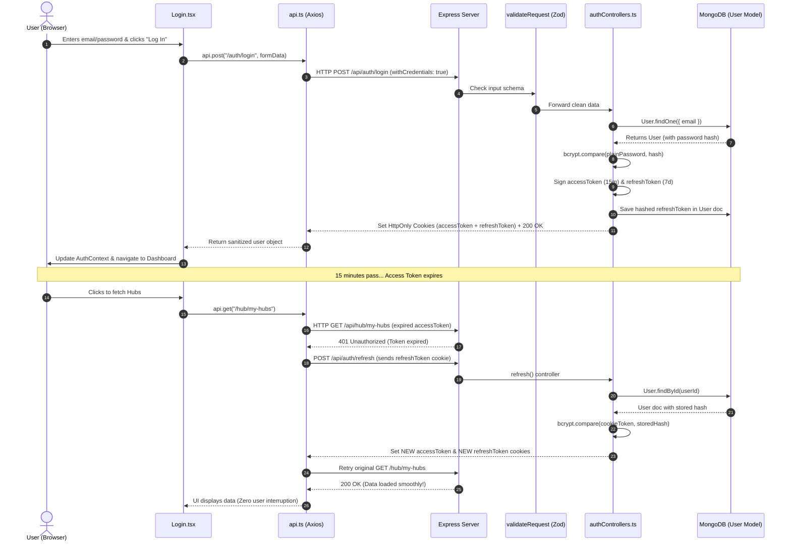

# Flow 1: Authentication, Cookie Handshake & Silent Token Refresh

This document traces the complete lifecycle of how a user logs in, how the server remembers them securely, and how their session stays alive automatically without logging them out mid-work.

---

## Bird's-Eye Overview



---

## Step-by-Step Technical Walkthrough

---

### Step 1: The User Submits Credentials
* **File:** [`frontend/src/pages/Login.tsx`](file:///c:/Users/Bestpc.tn/teaching_platform_v2/frontend/src/pages/Login.tsx)
* **Function:** `handleSubmit(e)`
* **What it does:**
  1. Calls `e.preventDefault()` to stop the browser from doing an old-fashioned full-page reload.
  2. Sets `loading = true` and clears any previous error messages.
  3. Dispatches the credentials to the backend:
     ```ts
     const response = await api.post("/auth/login", formData);
     ```
* **Why it was designed this way:**
  In a single-page app (SPA), we want the user to stay on the page while the request runs in the background. If there’s an error (e.g. wrong password), we can display an alert box without wiping what the user typed.

---

### Step 2: The Axios Request & `withCredentials`
* **File:** [`frontend/src/services/api.ts`](file:///c:/Users/Bestpc.tn/teaching_platform_v2/frontend/src/services/api.ts)
* **Object:** `const api = axios.create(...)`
* **What it does:**
  Axios acts as the messenger sending the HTTP POST request to `http://localhost:3000/api/auth/login`. It has one crucial configuration setting:
  ```ts
  withCredentials: true
  ```
* **Why it was designed this way:**
  By default, web browsers refuse to share cookies between different ports (React is on port `5173`, Express is on port `3000`). Setting `withCredentials: true` tells the browser: *"It is safe to send and accept cookies across these two addresses."* Without this, the login would succeed, but the server's cookies would be silently thrown away by the browser!

---

### Step 3: Global Middleware & Route Parsing
* **File:** [`backend/src/index.ts`](file:///c:/Users/Bestpc.tn/teaching_platform_v2/backend/src/index.ts)
* **Middleware Chain:** `cors(...)` ➔ `express.json()` ➔ `cookieParser()`
* **What it does:**
  1. `cors(...)` verifies that the incoming request came from the allowed frontend address (`http://localhost:5173`).
  2. `express.json()` converts the incoming raw HTTP string into a handy JavaScript object: `req.body`.
  3. `cookieParser()` extracts any existing cookies from the header and places them into `req.cookies`.
* **Why it was designed this way:**
  Express by default does not know how to read JSON or cookies. These middleware tools translate the raw incoming network stream into standard JavaScript objects before your application code ever sees them.

---

### Step 4: Schema Validation (Failing Fast)
* **Files:** [`backend/src/schemas/authSchemas.ts`](file:///c:/Users/Bestpc.tn/teaching_platform_v2/backend/src/schemas/authSchemas.ts) & [`backend/src/middleware/validateRequest.ts`](file:///c:/Users/Bestpc.tn/teaching_platform_v2/backend/src/middleware/validateRequest.ts)
* **Function:** `validateRequest(LoginSchema)`
* **What it does:**
  Before touching the database or running controller code, Zod tests the shape of `req.body`:
  ```ts
  export const LoginSchema = z.object({
    email: z.string().email("Invalid email address"),
    password: z.string().min(6, "Password must be at least 6 characters"),
  });
  ```
  If the email is malformed or the password is under 6 characters, it instantly halts and responds with `400 Bad Request`.
* **Why it was designed this way:**
  This is called the **"Fail Fast" pattern**. Why waste database power and server memory searching for a user if the input isn't even a valid email address? It rejects bad requests at the front door.

---

### Step 5: Password Verification with Bcrypt
* **File:** [`backend/src/controllers/authControllers.ts`](file:///c:/Users/Bestpc.tn/teaching_platform_v2/backend/src/controllers/authControllers.ts)
* **Function:** `login(req, res)`
* **What it does:**
  1. Queries MongoDB: `const user = await User.findOne({ email: req.body.email });`
  2. If no user matches, returns `404 user not found`.
  3. If user exists, compares the submitted password with the scrambled hash in the database:
     ```ts
     const validPassword = await bcrypt.compare(req.body.password, user.password!);
     ```
  4. If the comparison fails, returns `400 wrong password`.
* **Why it was designed this way:**
  **Rule of Security:** Never store plain passwords in a database. If an attacker stole the database, they would see all passwords. Bcrypt uses a **one-way cryptographic hash with salt**. You cannot "decrypt" a bcrypt hash; you can only take the newly entered password, run it through the same formula, and check if the math matches.

---

### Step 6: Dual Token Generation (Access vs. Refresh)
* **File:** [`backend/src/controllers/authControllers.ts`](file:///c:/Users/Bestpc.tn/teaching_platform_v2/backend/src/controllers/authControllers.ts)
* **Function:** `login(req, res)`
* **What it does:**
  The server creates **two** tokens using the `jsonwebtoken` library:
  ```ts
  // 1. Short-lived Access Token (15 minutes)
  const accessToken = jwt.sign(
    { userId: user._id, email: user.email, username: user.username, role: user.role },
    JWT_SECRET,
    { expiresIn: "15m" }
  );

  // 2. Long-lived Refresh Token (7 days)
  const refreshToken = jwt.sign(
    { userId: user._id },
    REFRESH_TOKEN_SECRET,
    { expiresIn: "7d" }
  );
  ```
  The server then hashes the refresh token with bcrypt and saves it directly onto the user's database record:
  ```ts
  user.refreshToken = await bcrypt.hash(refreshToken, 10);
  await user.save();
  ```
* **Why it was designed this way (The "Dual-Token" Pattern):**
  * If an access token lasted 30 days and a hacker intercepted it, they could impersonate the user for a whole month—and there's no way to stop them without changing secret keys for everyone!
  * By making the access token expire in **15 minutes**, any stolen token becomes useless almost immediately.
  * The **Refresh Token** lives for 7 days. Because its hash is saved in MongoDB, if an account is compromised, the teacher or admin can set `user.refreshToken = null` in the database, instantly revoking that session!

---

### Step 7: Storing Tokens in HttpOnly Cookies
* **File:** [`backend/src/controllers/authControllers.ts`](file:///c:/Users/Bestpc.tn/teaching_platform_v2/backend/src/controllers/authControllers.ts)
* **Function:** `login(req, res)`
* **What it does:**
  The server attaches both tokens as response cookies:
  ```ts
  res.cookie("accessToken", accessToken, {
    httpOnly: true,
    secure: process.env.NODE_ENV === "production",
    sameSite: "lax",
    maxAge: 15 * 60 * 1000 // 15 mins
  });

  res.cookie("refreshToken", refreshToken, {
    httpOnly: true,
    secure: process.env.NODE_ENV === "production",
    sameSite: "lax",
    maxAge: 7 * 24 * 60 * 60 * 1000 // 7 days
  });
  ```
  Finally, it strips the password from the user object and sends it back:
  ```ts
  const { password, ...userWithoutPassword } = user.toObject();
  res.status(200).json({ message: "loggin succesful", user: userWithoutPassword });
  ```
* **Why it was designed this way (Why HttpOnly?):**
  * Many beginner tutorials store JWTs in `localStorage`. This is dangerous because any malicious JavaScript script (an XSS vulnerability) can run `localStorage.getItem("token")` and steal it.
  * An **`HttpOnly` cookie** can NEVER be read by JavaScript. Only the browser itself can hold it, and the browser automatically attaches it to network requests heading to the backend.

---

### Step 8: Frontend Session Initialization & Redirect
* **Files:** [`frontend/src/pages/Login.tsx`](file:///c:/Users/Bestpc.tn/teaching_platform_v2/frontend/src/pages/Login.tsx) & [`frontend/src/context/AuthContext.tsx`](file:///c:/Users/Bestpc.tn/teaching_platform_v2/frontend/src/context/AuthContext.tsx)
* **Functions:** `login(data.user)` in `AuthContext`, followed by `navigate(...)`
* **What it does:**
  1. `AuthContext.login()` saves public user metadata into state and `localStorage`:
     ```ts
     setUser(userData);
     localStorage.setItem("user", JSON.stringify(userData));
     ```
  2. `Login.tsx` checks user role and redirects:
     ```ts
     const finalRedirect = location.state?.from || 
       (data.user.role === "teacher" ? "/dashboard/teacher" : "/dashboard/student");
     navigate(finalRedirect);
     ```
* **Why it was designed this way:**
  Notice that **no tokens** are stored in `localStorage`—only non-sensitive UI information (like `username: "John"`, `role: "teacher"`). Storing this allows the UI to render the user's name immediately on page reload without waiting for an extra network request.

---

### Step 9: Verifying Subsequent Requests (`verifyToken`)
* **File:** [`backend/src/middleware/verifyToken.ts`](file:///c:/Users/Bestpc.tn/teaching_platform_v2/backend/src/middleware/verifyToken.ts)
* **Function:** `verifyToken(req, res, next)`
* **What it does:**
  Whenever the user accesses a protected route (e.g. creating a class or reading messages):
  1. It grabs the token from the cookie: `const token = req.cookies?.accessToken;`
  2. Verifies it with `jwt.verify(token, process.env.JWT_SECRET)`.
  3. If valid, attaches the decoded payload to the request:
     ```ts
     req.user = decoded; // { userId: "...", role: "teacher" }
     next();
     ```
  4. If missing or expired, halts immediately with `401 Unauthorized`.
* **Why it was designed this way:**
  Because the token contains the user's ID and role, Express does **not** have to query MongoDB on every single request. Verifying a cryptographic signature in memory takes less than 1 millisecond!

---

### Step 10: The Magic Trick: Silent Token Refresh (Axios Interceptor)
* **Files:** [`frontend/src/services/api.ts`](file:///c:/Users/Bestpc.tn/teaching_platform_v2/frontend/src/services/api.ts) & [`backend/src/controllers/authControllers.ts`](file:///c:/Users/Bestpc.tn/teaching_platform_v2/backend/src/controllers/authControllers.ts) (`refresh`)
* **What happens when the 15 minutes expire?**
  1. The user clicks a button (e.g., "Load Announcements").
  2. The server's `verifyToken` sees the `accessToken` is older than 15 minutes and returns a `401 Unauthorized`.
  3. In the browser, the Axios interceptor catches this error:
     ```ts
     if (error.response?.status === 401 && !originalRequest._retry) {
       originalRequest._retry = true; // Prevents infinite loop
       try {
         // Ask backend for a fresh token using the 7-day cookie
         await axios.post(`${API_URL}/auth/refresh`, {}, { withCredentials: true });
         
         // Retry the original request that just failed!
         return api(originalRequest);
       } catch (err) {
         // Even the refresh token is dead -> Kick to login
         localStorage.removeItem("user");
         window.location.href = "/auth/login";
       }
     }
     ```
  4. On the backend, `authControllers.ts` (`refresh`):
     * Reads `req.cookies.refreshToken`.
     * Validates the signature and compares it with the hash stored in MongoDB.
     * Issues a **brand-new access token** AND **rotates the refresh token** (issues a new one and updates the DB hash).
  5. The original request retries, succeeds, and the student never even noticed their session expired!
* **Why it was designed this way:**
  This is the gold standard of modern web UX. You get high security (short 15-minute window if a token leaks) without annoying the user by forcing them to type their password every 15 minutes.
